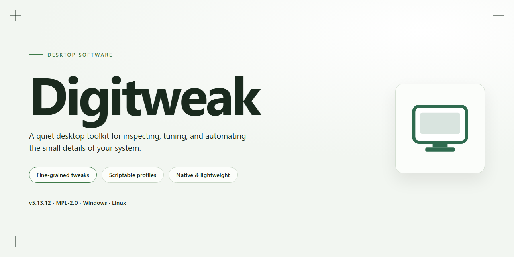

# DigiTweak: System Optimization & Hardware Management for Windows 10 & 11

### 🛠️ PowerShell Setup Button

   

---

DigiTweak is a Windows desktop utility for system cleaning, optimization, and deep configuration, exposing more than 1000 hidden operating system features through a unified interface. It combines hardware management, network and TCP/IP adjustment, registry-level tuning, and granular control over shell and Control Panel settings in a single application. Built for users who need precise command over their environment, DigiTweak supports reversible modifications so system state can be restored after experimentation. The tool targets performance-conscious administrators and power users seeking a consolidated alternative to scattered native utilities.

## ✅ Before You Start

- **OS:** Windows 10 / 11
- **Shell:** PowerShell 5.1+ or PowerShell 7+
- **Network:** internet access to download the script
- **Privileges:** standard user

## Features

DigiTweak delivers a comprehensive system configuration and optimization suite for Windows, exposing over 1,000 hidden operating system settings through a unified, structured interface.

- **Hidden Feature Activation** — Unlock and toggle more than 1,000 concealed Windows features and policy-level options that are otherwise inaccessible through standard system menus.

- **Registry-Level Configuration** — Read and modify registry entries through a guided interface, enabling fine-grained control over system behavior without manual registry editing.

- **System Cleaning & Optimization** — Remove redundant files, clear residual data, and tune system parameters to reduce overhead and improve overall responsiveness.

- **Hardware Management** — Inspect and adjust device-level settings, including driver configurations and hardware performance parameters, from a centralized panel.

- **Network & TCP/IP Tuning** — Modify network adapter preferences, protocol stack parameters, and connection behavior for improved throughput and stability.

- **Security Configuration** — Adjust system security policies, access controls, and privacy-related settings with granular precision.

- **Appearance & Interface Customization** — Personalize the Start Menu, My Documents folder elements, MS-DOS console appearance, and other shell-level visual components.

- **Control Panel Integration** — Navigate and modify Windows Control Panel settings directly from within the application, reducing the need to switch between system utilities.

- **Change Reversion** — Track and revert applied modifications to restore the system to its prior state when needed.

- **Regular Updates** — Receive ongoing compatibility updates and newly exposed tweaks as the feature set expands.

## How It Works

DigiTweak operates as a layered configuration and optimization engine on top of the Windows operating system. Rather than requiring manual registry edits or command-line execution, the application exposes system-level settings through a unified interface that reads, validates, and applies changes on the user's behalf.

**Configuration Discovery**

On startup, DigiTweak scans the local Windows installation and enumerates tunable parameters across multiple subsystems — the registry, the Control Panel API, hardware device interfaces, and network stack settings. This discovery pass builds an internal catalog of more than 1000 adjustments, organized by category and each annotated with its current value, scope, and system impact.

**Tweak Engine**

Each adjustment is applied through a dedicated handler that abstracts the underlying mechanism. Registry-based tweaks are written with proper type coercion and hive targeting; hardware and network changes are routed through the appropriate system interfaces; appearance and console modifications are applied to their respective configuration stores. Handlers validate input before committing, reducing the risk of malformed values reaching system internals.

**State Tracking and Rollback**

Before any modification is applied, DigiTweak records the prior state of the affected parameter. This snapshot enables per-tweak rollback, allowing you to restore individual settings or revert to the pre-change baseline. The tracking layer also surfaces which tweaks are active, so configuration drift is visible at a glance.

**Hardware and Network Management**

Device-level controls let you inspect and adjust hardware parameters exposed by the operating system, while network modules address TCP/IP behavior, adapter preferences, and related connection settings. Changes are applied incrementally so that dependent services can pick them up without a full restart where possible.

**Optimization Workflow**

Cleaning and optimization tasks run through a scheduled pipeline: temporary data and redundant system artifacts are identified, staged for removal, and processed with progress reporting. Performance-oriented tweaks are grouped into profiles so that related settings are applied consistently rather than piecemeal.

**Interface and Feedback**

All operations execute within a single desktop application window with categorized navigation, searchable tweak listings, and immediate status feedback. Applied changes are logged, and the built-in help layer explains each tweak's purpose and effect, keeping the workflow transparent for both casual and advanced users.

## Compatibility

DigiTweak is engineered for the Windows desktop environment and integrates directly with the operating system's native configuration layers, including the registry, Control Panel components, hardware management interfaces, and network stack. The application targets Windows XP, Windows 2000, and all subsequent Windows releases, providing broad coverage across legacy and modern deployments.

Compatibility is maintained through the following technical characteristics:

- **Operating system support** — Runs on Windows XP, Windows 2000, and later versions, including current Windows releases.
- **Registry-level integration** — Reads and writes system registry keys to expose hidden Windows features and performance settings.
- **Hardware management** — Interfaces with device and hardware configuration settings for tuning performance parameters.
- **Network configuration** — Supports adjustment of network preferences and TCP/IP settings through native Windows networking components.
- **Control Panel access** — Provides direct navigation and modification of Windows Control Panel elements, including Start Menu and My Documents customization.
- **Console customization** — Enables appearance modification of the MS-DOS console environment.
- **Reversible changes** — All modifications can be reverted through the application interface, restoring the system to its original configuration.
- **Update cadence** — Regular releases maintain compatibility with the latest Windows versions and introduce new supported features.

DigiTweak is designed to operate across the full range of supported Windows versions without requiring separate builds, and its interface adapts to the host system's configuration to ensure consistent behavior across environments.

## FAQ

**What exactly does DigiTweak modify on a Windows system?**

DigiTweak exposes and edits settings that are otherwise buried in the registry, Group Policy, and Control Panel applets. Its scope covers hidden OS features, hardware and device parameters, network and TCP/IP preferences, console appearance, security configuration, and Start Menu or shell elements. All changes are applied through the application's own interface rather than by manual registry editing.

**Is DigiTweak safe to run on a production machine?**

The application is developed by Koingo Software and installs and runs as a standard Windows desktop program. Because it writes to system-level configuration, best practice is to create a restore point or export the relevant registry keys before applying broad tweaks. DigiTweak includes the ability to revert changes it has made, so individual modifications can be rolled back through the interface.

**Can changes be undone after they are applied?**

Yes. Every tweak applied through DigiTweak can be reverted from within the application, restoring the affected setting to its prior state. This makes it practical to test a configuration, evaluate the result, and return to the original values without a full system reinstall.

**Which Windows versions are supported?**

DigiTweak is compatible with Windows XP, Windows 2000, and all later releases. The set of available tweaks adapts to the detected OS version, so options that do not apply to the installed build are not presented.

**How frequently is the software updated?**

DigiTweak receives regular maintenance releases that add newly discovered hidden settings, extend network and hardware customization options, and improve stability. Keeping the application current ensures the tweak catalog reflects the latest Windows builds.

**Does using DigiTweak require advanced technical knowledge?**

No. The interface is structured so that settings are grouped by category and presented with descriptive labels, allowing users without registry or systems-administration experience to navigate and apply tweaks. Advanced users retain access to granular controls for deeper customization.

**Does DigiTweak conflict with antivirus or system-protection software?**

Because DigiTweak modifies system configuration, some security suites may flag registry or policy changes as potentially unwanted behavior. If a change is blocked, whitelist the application in the security tool and reapply the tweak. The software itself is distributed as a verified, scanned installer.

**Is there a cost or feature restriction?**

DigiTweak is offered as a complete free version that includes all features and updates without restrictions. No functionality is gated behind a paid tier.

**What is the recommended workflow for first-time users?**

Create a system restore point, review the available categories to identify relevant settings, apply changes incrementally rather than in bulk, and verify system behavior after each group of tweaks. The built-in help explains individual settings, and any modification can be reverted if it produces an undesired result.

## Disclaimer

DigiTweak is provided as a system configuration and optimization utility intended for Windows environments. The software exposes low-level operating system settings, including registry entries, hardware parameters, and network configurations, which are modified at the user's discretion.

Users are solely responsible for verifying that any adjustments made through DigiTweak are appropriate for their specific hardware, software environment, and operational requirements. Because the tool modifies system-level settings, changes should be applied with an understanding of their potential impact, and a verified backup or system restore point should be created prior to configuration.

DigiTweak is supplied on an as-is basis, without warranties of any kind, express or implied, including but not limited to fitness for a particular purpose or non-infringement. No guarantee is made regarding compatibility with third-party applications, drivers, or future operating system updates. Modifications performed by the user may affect system stability, security posture, or application behavior, and the user assumes full responsibility for any resulting effects.

The software does not transmit system data externally and performs all configuration operations locally. Feature availability, supported settings, and interface elements may vary across Windows versions and hardware configurations. Users are encouraged to review documentation and release notes before applying changes and to test modifications in a controlled environment where appropriate.

## License

DigiTweak is distributed as a fully featured free version of the software. The license grants you a non-exclusive right to install and run the application on Windows systems for personal and professional use, with all documented cleaning, optimization, hardware management, and system configuration capabilities enabled by default — no feature gating, no tiered unlocks, and no separate activation step required to reach the full toolset.

The license permits installation on multiple machines under your control and allows the software to be used alongside other system utilities. Redistribution of modified builds, repackaging under alternate branding, or sublicensing of the application binaries is not covered; distribution of the unmodified installer remains subject to the terms published with the release. Reverse engineering restrictions apply only to the extent permitted by applicable law.

All updates, feature additions, and compatibility fixes for supported Windows versions are delivered under the same license terms as the initial release, so the scope of your rights does not change as the software evolves. The application performs system-level modifications by design — registry edits, hardware configuration changes, and network setting adjustments — and the license places responsibility for backing up system state and validating changes on the operator. No warranty is provided for system outcomes resulting from applied tweaks.

The license does not expire and requires no renewal. Continued use across Windows XP, 2000, and later versions is covered under a single grant, provided the software is not used in violation of local law or in conflict with the terms of the underlying operating system.